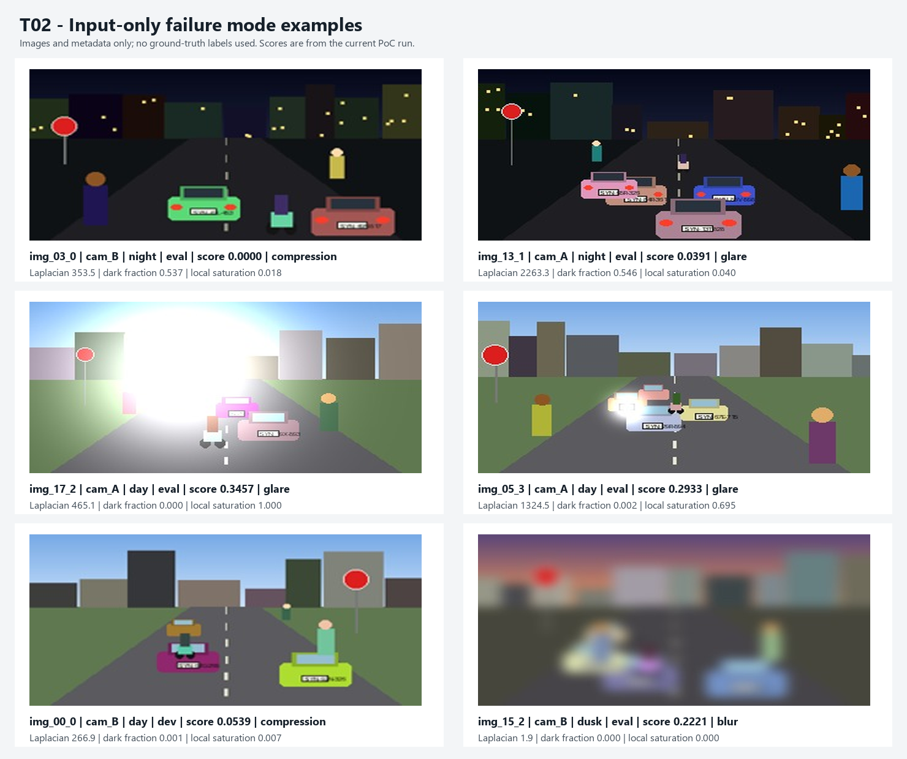

# T02 · Rà soát failure mode (chỉ dựa trên input)

Phân tích này chỉ dùng `images.csv`, `ranked_review.csv` được tạo ra và ảnh tổng hợp. Không đọc `gt/`; vì vậy đây là các trường hợp nghi ngờ lỗi của thuật toán qua quan sát ảnh, chưa phải false positive/false negative đã được xác nhận.

## Ảnh đêm có thể còn hữu ích nhưng được xếp hạng thấp

Phân lát eval ban đêm có 16 ảnh. Một số ảnh đêm còn chi tiết nhìn thấy ở mức vừa phải nhưng có điểm thấp, nằm ngoài ngân sách review 20 ảnh trên toàn bộ eval:

| Ảnh | Điểm | Lý do | Độ sáng trung bình | Tỷ lệ pixel tối | Phương sai Laplacian |
|---|---:|---|---:|---:|---:|
| `img_03_0` | 0.000037 | compression | 33.60 | 0.537 | 353.53 |
| `img_03_1` | 0.033676 | glare | 33.50 | 0.534 | 1859.77 |
| `img_13_1` | 0.039097 | glare | 34.79 | 0.546 | 2263.33 |
| `img_13_0` | 0.054297 | glare | 34.86 | 0.542 | 2231.74 |
| `img_01_1` | 0.059989 | glare | 31.61 | 0.633 | 1949.61 |

Đây có thể là các hard negative: độ sáng thấp và nhiều pixel tối là bình thường ở cảnh đêm, trong khi phương sai Laplacian cao cho thấy ảnh vẫn còn các biên nhìn thấy được. Nguyên nhân có thể là tín hiệu độ sáng vẫn làm tăng mức nghi ngờ ngay cả khi đã chuẩn hóa theo điều kiện chiếu sáng; thuật toán cũng không đánh giá được ý nghĩa của cảnh để biết người đi đường hoặc biển số còn sử dụng được hay không. `img_03_0` cho thấy tín hiệu ước lượng vết khối có thể gắn nhãn compression cho ảnh đêm. Cần xem ảnh ở kích thước đầy đủ; do bộ học viên không có GT, không thể xác nhận đây là lỗi phân loại.

## Lóa cục bộ có thể chi phối điểm của ảnh vốn nét

`img_17_2` là ảnh eval ban ngày, điểm 0.345697, lý do `glare`. Tỷ lệ pixel bão hòa toàn ảnh là 0.241, trong khi tỷ lệ ở ô 20 pixel bị bão hòa nhiều nhất là 1.0. Điều này phù hợp với một vùng sáng tập trung; contact sheet cũng cho thấy một vùng lớn bị cháy sáng. `img_05_3` là một trường hợp cần xem thêm: tỷ lệ bão hòa toàn ảnh 0.011, nhưng tỷ lệ ở ô sáng nhất là 0.695. Đặc trưng theo ô nhỏ giúp phát hiện vùng lóa tập trung, nhưng không xác định được vùng đó che biển số quan trọng hay chỉ là bầu trời không ảnh hưởng. Chuyển reviewer xem xét thêm là hợp lý cho tới khi đánh giá được mức độ liên quan của ROI.

## Độ nét phụ thuộc camera / cam_B

Trên tập dev, phương sai Laplacian trung vị là 955.0 với cam_A ban ngày (`n=24`) và 235.8 với cam_B ban ngày (`n=12`); cam_B lúc chạng vạng là 174.5 (`n=4`). Điều này cho thấy một ngưỡng độ nét toàn cục có thể nhầm đặc tính camera thành lỗi ảnh. PoC hiệu chỉnh độ nét theo camera và điều kiện sáng khi có ít nhất bốn mẫu dev, nhưng nhóm cam_B lúc chạng vạng nhỏ nên thống kê dễ biến động; ảnh bị lỗi trong nhóm có thể làm lệch giá trị tham chiếu. Ví dụ, `img_15_2` (cam_B, chạng vạng) có phương sai Laplacian 1.91 và điểm 0.222108; ảnh nhìn thấy rõ là bị mờ nhưng reviewer đã chọn SKIP. Ảnh cần được người review kết luận KEEP/RECAPTURE thay vì tự động quy nguyên nhân cho quang học camera. Chỉ so sánh trung vị không thể phân biệt quang học mềm với ảnh thực sự bị mờ. Vì fixture học viên không có GT, nhận xét này vẫn chỉ là giả thuyết trực quan, chưa xác nhận false alarm hay miss.

## Quyết định reviewer hiện tại

CSV hiện có 2 RECAPTURE, 6 KEEP, 8 SKIP và 4 HOLD trong 20 ảnh được xếp vào hàng đợi. Đặc biệt, không nên coi mọi ứng viên cảnh tối là không sử dụng được chỉ dựa vào độ sáng. Quyết định batch được giữ ở trạng thái HOLD vì các mục SKIP/HOLD chưa được kết luận. Fixture học viên không có GT, vì vậy không tính được Recall@20 và Precision@20 cho bản nộp này. Báo cáo nêu thời gian chạy cùng bằng chứng review thủ công và quan sát ảnh, không dùng chúng thay cho đánh giá có nhãn.
